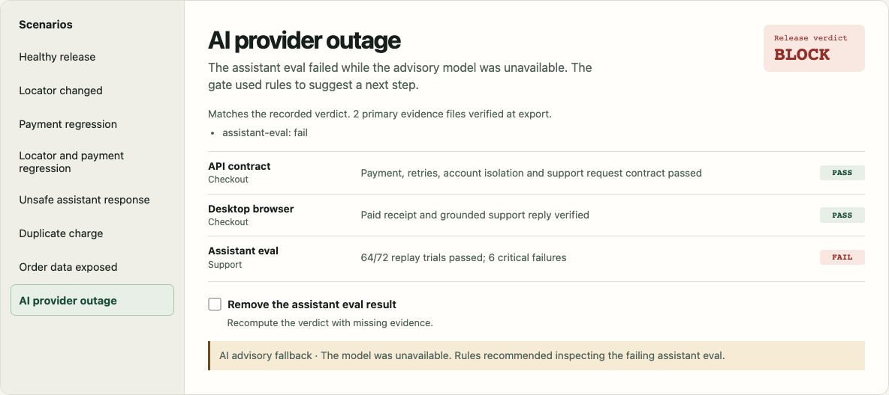

# Release Evidence Lab

Release Evidence Lab is a TypeScript project that demonstrates AI-assisted testing and release decisions. It uses a synthetic storefront to show which changes can ship, which need review, and which should be blocked.

The storefront has payment, order lookup, and a policy assistant. The release pipeline combines risk-based test selection, API and Playwright checks, and repeated model evals. A local model can suggest optional checks in shadow mode, recommend a triage step, and draft test recipes. The release policy produces `SHIP`, `REVIEW`, or `BLOCK`.

**[Open the interactive browser demo](https://tidal-linden-4dnd.here.now/)** to replay a release verdict, remove required evidence, or compare the AI model with deterministic triage.



Read the [five-minute demo](docs/DEMO.md), [AI reliability verification](docs/RELIABILITY.md), or [eval and judge benchmark](docs/EVAL.md).

## Tech stack and trade-offs

| Part | What it does | Why it was chosen | Trade-offs |
| --- | --- | --- | --- |
| TypeScript 5.9 | Defines test inputs, check results, and the release policy shared by the CLI and browser. | One policy implementation keeps the hosted replay aligned with the gate. Strict types catch mismatched IDs and result shapes during development. | Types are erased at runtime. Model output and saved reports still need runtime validation. |
| Node.js 26.3.0 and npm | Run the storefront, CLI, unit tests, HTTP contracts, and load smoke. The npm lockfile pins dependencies for repeatable installs. | Built-in HTTP, Fetch, and assertions keep setup small. The in-memory storefront makes faults easy to inject and reproduce. | Requires a recent Node release. In-memory state resets on restart and leaves database and distributed failures outside the demo. |
| Playwright and Chromium | Exercise checkout and support in desktop and mobile-emulated browser sessions. | The checks observe real requests and rendered receipts. Failure traces help distinguish a locator change from broken behavior. | Browser setup costs more time than unit or API tests. Chromium emulation leaves physical devices and other browser engines outside coverage. |
| Deterministic gate and SHA-256 evidence | Produce and replay `SHIP`, `REVIEW`, or `BLOCK`. Hashes detect changes to primary evidence files. | Explicit rules make decisions reproducible and preserve required checks even if the AI provider fails. | Check selection rules need maintenance. Hashes verify file consistency, and authenticity depends on a trusted runner or signed provenance. |
| Golden cases and fault injection | Score assistant replies, benchmark the judge against reference labels, and verify that proposed tests catch known faults. | Repeated trials expose intermittent failures. Known faults give generated tests an observable success criterion. | Synthetic cases cover a limited set of failures. The judge comparison uses authored reference labels, and both the cases and rubric need upkeep. |
| Ollama and Llama 3.2 | Provide optional local model runs for support evaluation, judging, triage, and test drafting. | Loopback inference keeps inputs on the machine and works without a hosted model key. The benchmark records the model digest for comparison. | Hardware and model startup affect latency. Responses can vary, and deterministic triage performed better in the recorded benchmark. |
| GitHub Actions | Runs the checks on pushes and pull requests, verifies the saved release report, and uploads evidence. | The same commands work locally and in CI. A reviewer can inspect the run and its artifacts from the repository. | CI adds runner and browser installation time. The workflow retains uploaded artifacts for 14 days. |
| HTML, CSS, and browser JavaScript | Render the interactive demo and run the shared release policy against recorded evidence. | A small static bundle loads without a frontend framework. Visitors can remove a required result and immediately see how the verdict changes. | The evidence is a snapshot. Refreshing it requires exporting a new run, and fresh API, browser, or model tests run outside the page. |
| here.now | Hosts the static demo at a public URL. | Visitors can open it without installing the stack, and the hosted bundle requires no inference credentials. | Site updates require a new publish. Running the full test pipeline online requires separate compute, such as CI for Playwright. |

See the [architecture](docs/ARCHITECTURE.md) and [measured reliability results](docs/RELIABILITY.md) for the evidence behind these choices.

## Run it

Use Node **26.3.0** (see `.node-version`) and npm. Install dependencies and Chromium once. The default gate and fault demo run without model credentials, cloud accounts, or Ollama.

```sh
npm ci --ignore-scripts
npx playwright install chromium
npm run typecheck
npm test
npm run demo
```

The demo prints the path to a new `artifacts/demo-*/comparison.md`. It verifies each saved release report and checks the expected decision, exit code, and findings. The comparison links to the AI reliability checks. A failure caused by a missing browser cannot accidentally satisfy the fault matrix.

| Candidate | Expected result | Why |
| --- | --- | --- |
| Healthy | SHIP | Required and selected checks pass. |
| Checkout button test ID renamed | REVIEW | The verified replacement passes the same payment and receipt checks. |
| Approved payments decline | BLOCK | The API and browser detect failed checkout. |
| Rename plus payment regression | BLOCK | The replacement cannot hide the broken checkout. |
| Intermittent unsupported advice or policy claim | BLOCK | Multiple eval trials catch errors that seed zero misses. |
| Duplicate charge on retry | BLOCK | Idempotency contract fails. |
| Another shopper's receipt is visible | BLOCK | Account isolation contract fails. |

Run the gate once with a targeted selection, or open the storefront in a browser:

```sh
npm run gate -- --changed src/app/support.ts --out artifacts/support-change
npm start
# Open http://127.0.0.1:4173; stop the server with Ctrl+C.
```

Use a fresh output directory for each gate run. The default is `artifacts/gate`. The gate writes Markdown, JSON, and supporting test evidence; exit codes are `0` for ship, `2` for review, and `1` for block. The [GitHub Actions workflow](.github/workflows/quality.yml) runs the same gate, publishes the job summary, and uploads evidence even when the gate fails.

## Verify the AI layer

Run `npm run verify:ai -- --replay` to exercise forged model verdicts, invalid actions, and provider outages. Set `OLLAMA_AGENT_MODEL=llama3.2:latest` and run `npm run verify:ai` to measure live triage accuracy, stability, and latency against rules. Use `npm run verify:release -- --dir artifacts/gate` to replay the gate decision and check its evidence files. [Reliability design and measured results](docs/RELIABILITY.md)

## Test with AI and test the AI

Run `npm run eval:score` for the 24-case golden set and category-level results. See [the judge rubric and disagreement analysis](docs/EVAL.md).

Ollama runs on the local machine. The scripts use an already installed model tag and record its digest. The examples below use `llama3.2:latest`; the checked-in live run shows where that model failed.

```sh
# Draft two constrained recipes and qualify them against injected faults.
npm run ai:proposals
OLLAMA_AGENT_MODEL=llama3.2:latest npm run ai:proposals

# Triage a failing candidate. Expect exit 1 from the release policy.
OLLAMA_AGENT_MODEL=llama3.2:latest npm run gate -- \
  --scenario eval-regression --out artifacts/advised

# Evaluate the live product candidate and calibrate a judge.
OLLAMA_JUDGE_MODEL=llama3.2:latest npm run judge:benchmark
OLLAMA_PRODUCT_MODEL=llama3.2:latest OLLAMA_JUDGE_MODEL=llama3.2:latest \
  npm run ai:eval
```

The live benchmark exits nonzero on a hard eval failure, failed judge calibration, or an adverse/abstaining eligible judge. The same live model adapter can serve the local synthetic fixture using `OLLAMA_PRODUCT_MODEL=llama3.2:latest npm start`. The default CI verdict qualifies the **replay fixture**. A real model or prompt promotion needs its own live evidence.

| Capability | Implementation |
| --- | --- |
| Release decisions | [Release policy](src/quality/policy.ts), [CI gate](.github/workflows/quality.yml), [architecture](docs/ARCHITECTURE.md) |
| AI-assisted selection and triage | [Change rules](src/quality/policy.ts) always keep critical checks; [shadow selection](src/quality/shadow-selection.ts) compares optional coverage; [local triage](src/quality/advice.ts) suggests a next step |
| Guarded self-healing | [Scoped Playwright recovery](tests/e2e/shop.spec.ts) preserves the request, payment, and receipt assertions; combined fault blocks |
| Test AI-generated behavior | [Recipe qualification](src/quality/proposals.ts) validates a small DSL, then requires passing the baseline and catching the intended mutant |
| Evaluate product AI | [Golden cases](src/quality/golden.ts), [repeated trials](src/quality/eval.ts), [judge calibration](src/quality/judge.ts) |
| Verify customer journeys and operational risks | HTTP contracts, desktop and mobile Chromium emulation, concurrent local checkout smoke, and [incident exercise](docs/INCIDENT.md) |

The project uses synthetic data. The browser mobile lane uses emulation, and the load probe is a local regression smoke test. [Release Quality workflow runs](https://github.com/jsayram/ai-enabled-testing-pipeline-hh/actions/workflows/quality.yml)
