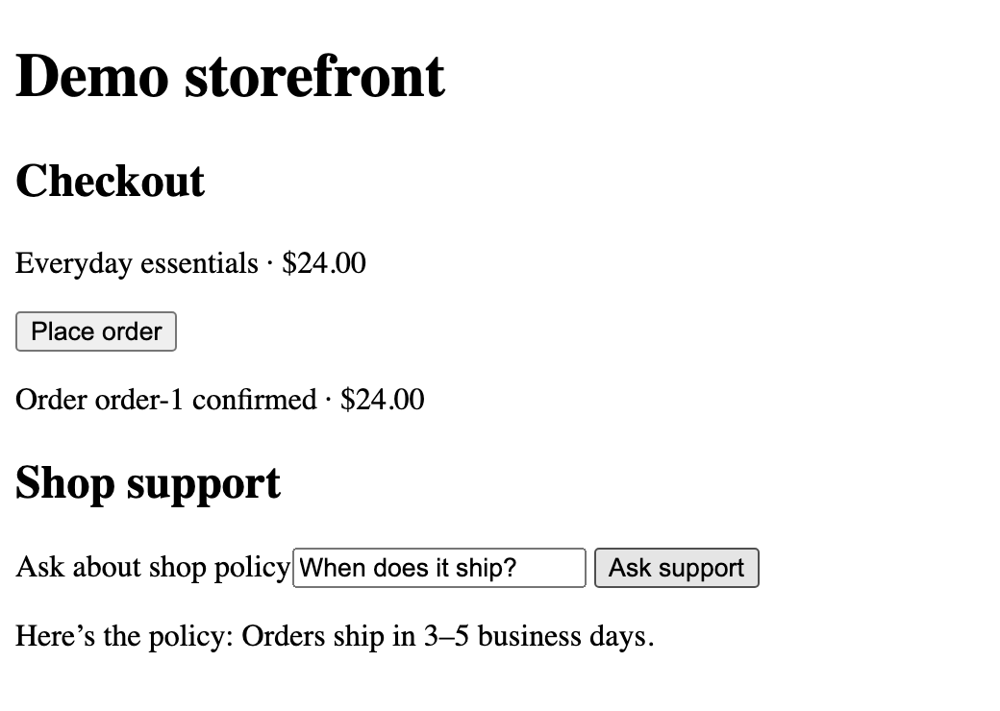

# Release Evidence Lab

Release Evidence Lab is a TypeScript project that demonstrates AI-assisted testing and release decisions. It uses a synthetic storefront to show which changes can ship, which need review, and which should be blocked.

The storefront has payment, order lookup, and a policy assistant. The release pipeline combines risk-based test selection, API and Playwright checks, and repeated model evals. A local model can suggest optional checks in shadow mode, recommend a triage step, and draft test recipes. The release policy produces `SHIP`, `REVIEW`, or `BLOCK`.

**Start with [the eval and judge benchmark](docs/EVAL.md), [the measured results](docs/evidence/README.md), [the five-minute demo](docs/DEMO.md), or [the architecture and rollout plan](docs/ARCHITECTURE.md).**



## Run it

Use Node **26.3.0** (see `.node-version`) and npm. Install dependencies and Chromium once. The default gate and fault demo run without model credentials, cloud accounts, or Ollama.

```sh
npm ci --ignore-scripts
npx playwright install chromium
npm run typecheck
npm test
npm run demo
```

The demo prints the path to a new `artifacts/demo-*/comparison.md`. It asserts the decision, exit code, and specific failed or reviewed checks in each scenario. A failure caused by a missing browser cannot accidentally satisfy the fault matrix.

| Candidate | Expected result | Why |
| --- | --- | --- |
| Healthy | SHIP | Required and selected checks pass. |
| Checkout button test ID renamed | REVIEW | The verified replacement passes the same payment and receipt checks. |
| Approved payments decline | BLOCK | The API and browser detect failed checkout. |
| Rename plus payment regression | BLOCK | The replacement cannot hide the broken checkout. |
| Intermittent unsupported advice or policy claim | BLOCK | Multiple eval trials catch errors that seed zero misses. |
| Duplicate charge on retry | BLOCK | Idempotency contract fails. |
| Another shopper's receipt is visible | BLOCK | Account isolation contract fails. |

Run the gate once with a targeted selection, or open the storefront in a browser:

```sh
npm run gate -- --changed src/app/support.ts --out artifacts/support-change
npm start
# Open http://127.0.0.1:4173; stop the server with Ctrl+C.
```

Use a fresh output directory for each gate run. The default is `artifacts/gate`. The gate writes Markdown, JSON, and supporting test evidence; exit codes are `0` for ship, `2` for review, and `1` for block. The [GitHub Actions workflow](.github/workflows/quality.yml) runs the same gate, publishes the job summary, and uploads evidence even when the gate fails.

## Test with AI and test the AI

Run `npm run eval:score` for the 24-case golden set and category-level results. See [the judge rubric and disagreement analysis](docs/EVAL.md).

Ollama runs on the local machine. The scripts use an already installed model tag and record its digest. The examples below use `llama3.2:latest`; the checked-in live run shows where that model failed.

```sh
# Draft two constrained recipes and qualify them against injected faults.
npm run ai:proposals
OLLAMA_AGENT_MODEL=llama3.2:latest npm run ai:proposals

# Triage a failing candidate. Expect exit 1 from the release policy.
OLLAMA_AGENT_MODEL=llama3.2:latest npm run gate -- \
  --scenario eval-regression --out artifacts/advised

# Evaluate the live product candidate and calibrate a judge.
OLLAMA_JUDGE_MODEL=llama3.2:latest npm run judge:benchmark
OLLAMA_PRODUCT_MODEL=llama3.2:latest OLLAMA_JUDGE_MODEL=llama3.2:latest \
  npm run ai:eval
```

The live benchmark exits nonzero on a hard eval failure, failed judge calibration, or an adverse/abstaining eligible judge. The same live model adapter can serve the local synthetic fixture using `OLLAMA_PRODUCT_MODEL=llama3.2:latest npm start`. The default CI verdict qualifies the **replay fixture**. A real model or prompt promotion needs its own live evidence.

| Capability | Implementation |
| --- | --- |
| Release decisions | [Release policy](src/quality/policy.ts), [CI gate](.github/workflows/quality.yml), [architecture](docs/ARCHITECTURE.md) |
| AI-assisted selection and triage | [Change rules](src/quality/policy.ts) always keep critical checks; [shadow selection](src/quality/shadow-selection.ts) compares optional coverage; [local triage](src/quality/advice.ts) suggests a next step |
| Guarded self-healing | [Scoped Playwright recovery](tests/e2e/shop.spec.ts) preserves the request, payment, and receipt assertions; combined fault blocks |
| Test AI-generated behavior | [Recipe qualification](src/quality/proposals.ts) validates a small DSL, then requires passing the baseline and catching the intended mutant |
| Evaluate product AI | [Golden cases](src/quality/golden.ts), [repeated trials](src/quality/eval.ts), [judge calibration](src/quality/judge.ts) |
| Verify customer journeys and operational risks | HTTP contracts, desktop and mobile Chromium emulation, concurrent local checkout smoke, and [incident exercise](docs/INCIDENT.md) |

The project uses synthetic data. The browser mobile lane uses emulation, and the load probe is a local regression smoke test. [Release Quality workflow runs](https://github.com/jsayram/ai-enabled-testing-pipeline-hh/actions/workflows/quality.yml)
