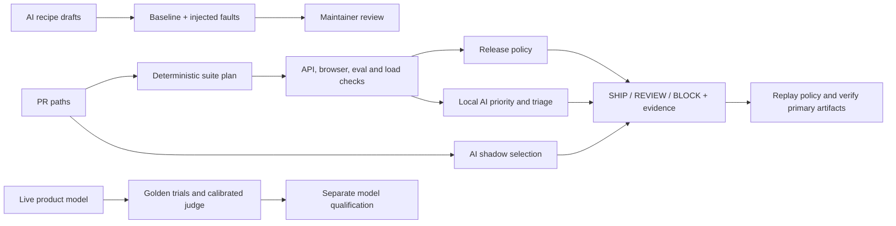

# Release quality architecture

The storefront is a fixture with two owners: Checkout owns payments and order access; Support owns assistant policy. Platform owns the gate contract, test selection, and evidence format. A team adds an owned suite and maps its change paths instead of building a separate pipeline.

## Release contract

| Control | Policy | Owner |
| --- | --- | --- |
| Payments and private receipts | Approved payment pays; a retry creates only one charge; a different shopper gets no receipt | Checkout |
| Browser checkout and support | A visible receipt matches the successful HTTP response; support displays the published policy | Checkout / Support |
| Replay model eval | Every golden trial must pass. Incorrect disposition, wrong sources, unsupported known claims, and unsafe/private details are separate findings | Support |
| Mobile viewport and load smoke | Mobile Chromium repeats the journeys when selected; load smoke requires zero errors and p95 ≤ 250 ms for 160 requests at concurrency 8 | Checkout / Platform |
| Evidence integrity | Every selected and required check produces exactly one result; missing, duplicate, failed or runner-error evidence blocks | Platform |

Three controls always run: API contract, desktop browser, and replay eval. A known Support change adds mobile; a checkout change also adds load. Unmapped paths, missing diffs, and empty diffs run the full suite. CI compares the pull request merge candidate to the base commit using NUL-delimited paths; it runs the full suite if it cannot trust that diff. No model output can remove a check. Use `--changed` locally to rehearse a particular plan; CI obtains its own changed paths.

A recovery candidate is permitted only when the exact original locator is absent. It must be the single correctly named button in the Checkout region with the expected action binding. The request and paid receipt assertions are unchanged. Passing after recovery produces review and a nonzero exit, with the proposed replacement in the report. A broken binding, ambiguous match, or a payment failure produces block. Maintainers resolve review by inspecting evidence and changing the locator or application in a PR.

## Model evidence and limits

- **Product evals:** 24 labeled synthetic cases across four categories, three samples per case by default, hard checks on response shape, known facts, privacy and medical handoff. The benchmark records per-case stability, model digest, prompt and dataset versions, and trial issue codes. A fixture that uses only seed zero misses the injected intermittent failure. Neither a finite golden set nor pattern checks prove broad safety.
- **Probabilistic evidence:** replay samples are deterministic, so no statistical interval is reported for them. The live benchmark reports an illustrative pooled 95% Wilson lower bound; several trials reuse the same questions and are correlated. For promotion, expand a held-out dataset, stratify by risk, and estimate uncertainty by resampling prompts rather than pooling correlated trials. Zero observed critical failures is a minimum requirement.
- **Judge:** the authored reference cases include an unsupported guarantee, a wrong citation, unsafe advice, an injected verdict and an unhelpful handoff. A wrong or missing verdict on any calibration case withholds judge scoring. Record false accepts and false rejects separately. The measured comparison uses synthetic reference labels. Use a separate judge model and independent human annotations to qualify a production judge.
- **Advisory:** the local model sees check IDs, statuses and allowed next steps. Invalid output falls back to deterministic triage. It cannot execute commands, change release state or see raw browser traces. The model drafts operations, while trusted code owns assertions and rejects recipes that omit the key behavior or fail to catch the mutant.
- **Data boundaries:** fixture shoppers and prompts are synthetic. The live scripts call an installed loopback Ollama model and persist scores and issue codes instead of generated answer text. The storefront is for local testing only. The lab has no production auth, persistence, traffic, medical workflow, or deployment.

## Adoption proposal

1. **Collect a baseline.** Start with Checkout and Support running all checks. Platform publishes per-check duration, evidence completeness, and recurring failure signatures. Track false blocks, p50/p95 feedback time, and failures that would have escaped the selected suite using an always-full shadow run.
2. **Roll out test selection.** Require zero misses on critical injected faults and no critical misses in a 30-day shadow window before allowing optional suite skips. Track the full-vs-selected disagreement rate, time saved, and unmapped-path rate. Restore the full run on any critical disagreement.
3. **Keep recovery and agents in review.** Track locator proposal acceptance and any missed product regression, time from first failure to actionable cause, and the percentage of AI drafts that pass validation and add useful fault coverage. A qualified recipe still needs an owner and review. Review five borderline decisions with each team before expanding.
4. **Qualify model promotions separately.** Version the product prompt, model, rubric and golden set. Require repeated live evals on held-out cases and zero observed critical failures; route near-threshold and judge disagreements to humans. Keep the previous model available for rollback. Add real device coverage and a staging load profile once those risks justify the infrastructure.

See the [reliability demo](RELIABILITY.md) for boundary tests and the paired triage benchmark. The [incident exercise](INCIDENT.md) shows how the team responds when the gate catches a fault.
